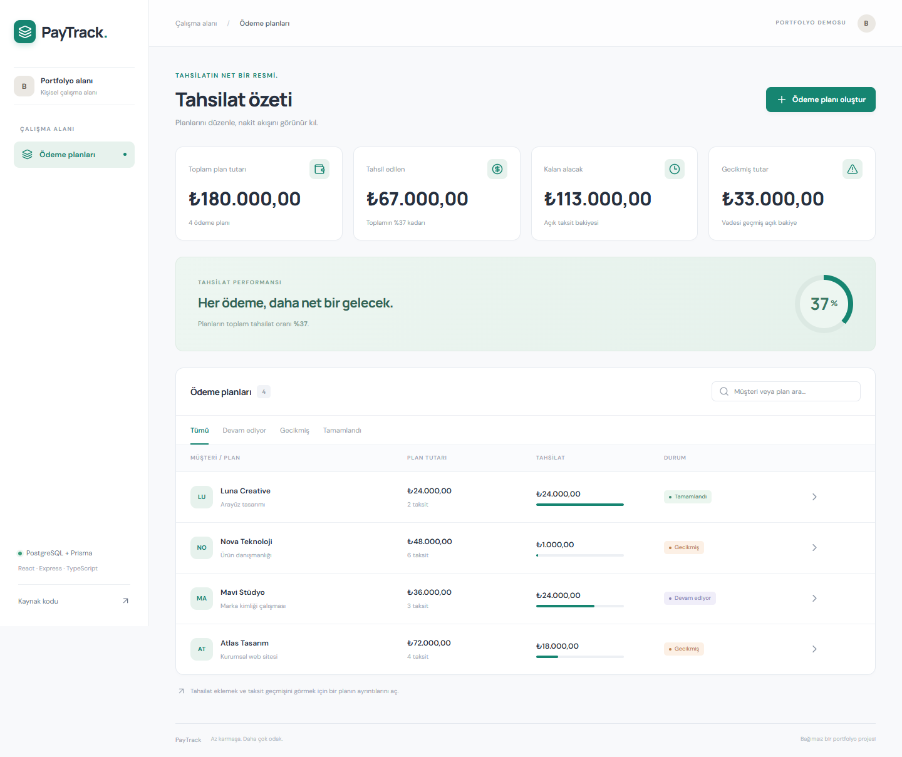

# PayTrack

Tahsilatın net bir resmi. Müşteri ödeme planlarını ve taksit tahsilatlarını izleyen bir uygulama.

React + TypeScript · Express + TypeScript · PostgreSQL + Prisma. Next.js içermez.



[Telefon görünümü](docs/mobile.png)

## Özellikler

- Müşteri bilgileriyle aylık ödeme planı
- Tam sayı kuruş üzerinden kayıpsız taksit dağılımı
- Ay sonunu koruyan vade hesabı
- Kısmi tahsilat, tahsilat geçmişi ve geciken bakiye
- Satır kilidiyle eşzamanlı fazla ödeme koruması
- Aynı idempotencyKey ile yinelenen isteğe tek tahsilat

## Yerel kurulum

Gereksinimler: Node.js 22.12+, npm ve Docker Compose. PostgreSQL için Docker yerine kendi sunucunu kullanacaksan backend/.env içindeki DATABASE_URL değerini değiştir.

```sh
git clone https://github.com/hassanbera/paytrack.git
cd paytrack
npm ci
npm run db:up
npm run setup
npm run dev
```

- Arayüz: http://localhost:5174
- API: http://localhost:4102/api
- Sağlık: http://localhost:4102/api/health
- Yerel PostgreSQL: localhost:55442

`npm run setup`, yoksa backend/.env dosyasını örnekten oluşturur; Prisma Client üretir, sürümlenmiş migration'ları uygular ve örnek verileri ekler. Seed yalnızca boş uygulamaya demo kayıtları ekler, mevcut kayıtları silmez. Compose sadece PostgreSQL'i başlatır; API ve arayüz host üzerinde çalışır. `npm run db:down` veritabanını durdurur; volume içindeki veriler korunur.

## Mimari

```text
frontend/src/
  App.tsx                  # Kullanıcı akışları ve ekran
  components/ui.tsx        # Ortak arayüz bileşenleri
  lib/api.ts               # HTTP istemcisi
  types.ts                 # İstemci veri tipleri
backend/
  prisma/schema.prisma     # Kalıcı veri modeli
  prisma/migrations/       # Sürümlenmiş PostgreSQL migration'ları
  prisma.config.ts         # Prisma CLI bağlantı yapılandırması
  prisma/seed.ts            # Tekrarlanabilir demo kurulumu
  src/modules/paytrack/
    paytrack.model.ts       # Girdi şemaları, tipler ve model kuralları
    paytrack.repository.ts  # Prisma ve veritabanı işlemleri
    paytrack.service.ts     # İş akışları ve iş kuralları
    paytrack.controller.ts  # HTTP giriş / çıkış
    paytrack.routes.ts      # Endpoint eşlemeleri
  src/config/              # Ortam ve Prisma bağlantısı
  src/common/              # Merkezi hata yönetimi
```

İstek akışı: Route → Controller → Service → Repository → Prisma → PostgreSQL. Controller veritabanına erişmez. İlişkiler, indeksler ve silme davranışları Prisma şemasında tanımlıdır. Repository, iş akışının ihtiyaç duyduğu atomik transaction'ları sağlar.

## API

Başarılı yanıtlar `{ "data": ... }`, hatalar `{ "error": "..." }` biçimindedir. Geçersiz girdi 400, eksik kayıt 404, çakışma 409 döndürür.

| Yöntem     | Yol                            | İşlem                                            |
| ---------- | ------------------------------ | ------------------------------------------------ |
| GET        | /api/health                    | Veritabanı bağlantısı dahil sağlık               |
| GET / POST | /api/plans                     | Planlar / yeni plan                              |
| GET        | /api/plans/:id                 | Taksit ve tahsilat ayrıntıları                   |
| POST       | /api/installments/:id/payments | Tahsilat ekle; amountCents, note, idempotencyKey |

## Doğrulama

```sh
npm run typecheck
npm test
npm run build
```

Testler gerçek PostgreSQL üzerinde HTTP API ve kritik iş kurallarını doğrular. Test komutu kendine ait rastgele isimli bir veritabanı oluşturur, migration uygular ve test sonunda yalnızca bu veritabanını siler. Geliştirme worker’ı ve demo verileri testlere karışmaz. Yerel veritabanı kullanıcısında CREATEDB yetkisi gerekir; Compose ve CI kullanıcısında bu yetki vardır. CI şablonu migration, tip kontrolü, test ve build adımlarını içerir. Yerelde test öncesi `npm run setup` çalışmış olmalıdır.

## GitHub Actions

CI tanımı [docs/github-actions-ci.yml](docs/github-actions-ci.yml) içinde hazırdır. İlk gönderimde kullanılan GitHub bağlantısında workflow yazma yetkisi bulunmadığı için otomatik CI henüz etkin değildir. Yerel test ve build komutları çalışır.

Workflow yazma yetkili bir GitHub oturumunda:

```sh
npm run ci:enable
git add .github/workflows/ci.yml
git commit -m "Enable CI"
git push
```

## Yapılandırma ve sınırlar

- Bu sürüm tek çalışma alanlı bir portfolyo demosudur. Giriş ve kullanıcı bazında veri izolasyonu içermez; tüm ziyaretçiler aynı demo kayıtlarını görür ve değiştirir. Özel müşteri verisiyle veya erişimi kısıtlanmamış üretim API'si olarak kullanmadan önce kimlik doğrulama ve yetkilendirme eklenmelidir.
- Sunucu ve Vite geliştirme arayüzü varsayılan olarak yalnızca yerel makineyi dinler. Her proje kendi PostgreSQL volume ve portlarını kullanır.
- Parola ve bağlantı bilgileri yalnızca yerel demo içindir; gerçek dağıtımda environment secret kullan. .env dosyaları Git'e eklenmez.
- Üretim arayüzü için `frontend/dist` statik olarak sunulabilir. Aynı origin altında `/api` isteklerini Express sunucusuna yönlendir. Express'i `npm start -w backend` ile başlat; ters proxy/container kullanırken `HOST=0.0.0.0` değerini dağıtım ortamında tanımla.
- Backend derlemesi ve Prisma migration işlemleri dağıtımda ayrı adımlardır. Sürümler package-lock.json ile sabitlenir; bu başlangıç Prisma 7.10.1 kullanır.
- Tüm tutarlar TRY ve tam sayı kuruş cinsindedir. Faiz, vergi, banka entegrasyonu ve muhasebe fişi içermez. Gecikme, tarayıcıda Europe/Istanbul gününe göre gösterilir. Tahsilat düzeltme/iade bu sürümün kapsamı dışındadır.
